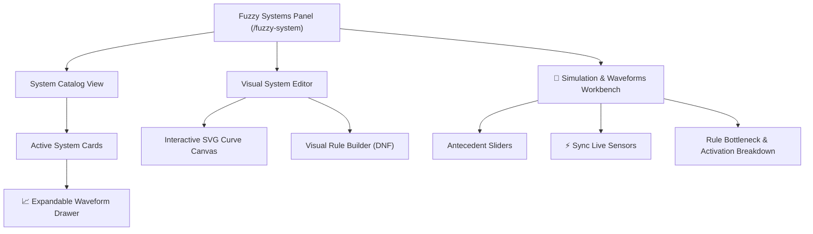
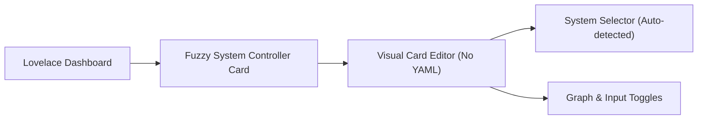
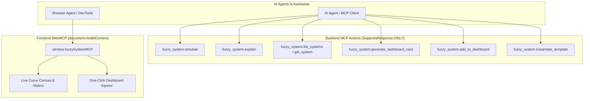
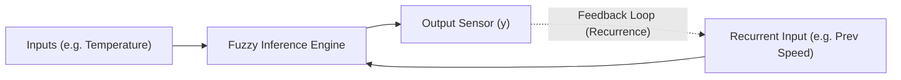

# Fuzzy System Custom Component for Home Assistant

The **Fuzzy System** custom component brings Mamdani and Sugeno fuzzy logic control systems to Home Assistant. Combine sensors with linguistic rules, hedges, custom membership functions, and various defuzzification strategies to create smart control entities (such as tipping systems, dynamic climate controls, lighting adjusters, and comfort indices).

> **Credits & Acknowledgments**: Powered by [scikit-fuzzy (`skfuzzy`)](https://github.com/scikit-fuzzy/scikit-fuzzy) ([PyPI](https://pypi.org/project/scikit-fuzzy/)), a robust fuzzy logic library built on top of SciPy. Special thanks to the `scikit-fuzzy` maintainers and contributors for providing the underlying membership math and defuzzification algorithms!

> 📖 **Visual Tutorial**: See our [**Step-by-Step Visual Tutorial & Walkthrough**](docs/tutorial.md) with interface screenshots for creating systems, dragging SVG curves, building rules visually, and setting up dashboard cards without writing YAML.

---

## Project Goals

The primary goal of this project is to implement **Fuzzy Control for Home Assistant**, enabling declarative, human-like reasoning for smart home automations without brittle threshold formulas or complex PID tuning.

### Core Objectives
1. **Declarative Linguistic Control**: Allow users to define natural language control rules (`IF temperature IS hot AND humidity IS humid THEN fan_speed IS high`) mapped to mathematical fuzzy membership functions and linguistic hedges.
2. **Robust Inference Engines**: Support both Mamdani and Sugeno (zero-order and first-order) fuzzy inference with 8 defuzzification algorithms (`cog`, `coa`, `boa`, `cos`, `mom`, `som`, `lom`, `weighted_average`).
3. **Reactive Home Assistant Integration**: Dynamically monitor Home Assistant entity states (sensors, input numbers, helpers) and re-evaluate fuzzy systems in real-time as inputs update.
4. **Deep Observability & Lovelace Visualization**: Expose both crisp defuzzified state values and rich diagnostic attributes (`rule_strengths`, `term_memberships`, pre-defuzzified dominant sets, and aggregated curve distributions) for Lovelace dashboards.
5. **Distribution & Setup Options**:
   - Support standard YAML configuration and UI Config Flow.
   - Maintain seamless installation via HACS (Home Assistant Community Store).
6. **Code Quality & Quality Scale (Gold Certified)**: Certified **Gold** (minimum Silver) on the [Home Assistant Quality Scale](https://contributors.home-assistant.io/core/quality-scale/), enforcing strictly $\ge 95\%$ test coverage in CI, typed `entry.runtime_data` architecture, native diagnostics platform, reconfiguration flow, and automatic repair issue tracking.
7. **Eventual Home Assistant Core Integration**: Architect, test, and document the integration to meet Home Assistant Core architectural standards for eventual adoption into Home Assistant Core as a first-class built-in helper (alongside Threshold, Derivative, Min/Max, and Filter).
8. **Autonomous Agent & Dashboard Synthesis (MCP & WebMCP)**: Empower AI agents (such as Claude, Gemini, ChatGPT, or Antigravity) to reason about, author, tune, simulate, and automatically publish companion Lovelace dashboard displays using Home Assistant's Model Context Protocol (MCP) server and the browser-native W3C WebMCP standard.

---

## Neurosymbolic Design: Bridging Modern Generative AI & Classical Old-School AI

This integration represents a deliberate **neurosymbolic and hybrid-AI architecture**—bringing together modern statistical AI (Large Language Models) with classical "old school" rule-based AI (Fuzzy Logic and Approximate Reasoning):

```mermaid
graph LR
    subgraph ModernAI["Modern Generative AI (Neural / Probabilistic)"]
        LLM["Large Language Models (LLMs)"]
        Agents["Autonomous AI Agents"]
        Dev["AI-Assisted Engineering"]
    end

    subgraph Interface["Open Agent Protocols"]
        MCP["Model Context Protocol (MCP)"]
        WebMCP["Browser WebMCP (document.modelContext)"]
    end

    subgraph ClassicalAI["Old-School AI: Fuzzy Logic (Deterministic / Interpretable)"]
        FL["Fuzzy Logic Control (Lotfi Zadeh, 1965)"]
        Rules["Linguistic Rules & Hedges"]
        Engine["Mamdani & Sugeno Inference Engines"]
    end

    subgraph Output["Home Assistant Environment"]
        Edge["Deterministic Local Execution (0ms Latency)"]
        Dashboards["Auto-Generated Lovelace Dashboards"]
    end

    ModernAI --> Interface
    Interface --> ClassicalAI
    ClassicalAI --> Output
```



### 1. Old-School AI: Capturing Human Heuristics at the Edge
Fuzzy Logic—pioneered by Lotfi Zadeh in 1965—is a classic cornerstone of **old-school artificial intelligence** from the golden era of expert systems and automated control. While humans rarely think in rigid binary thresholds (*"turn on the AC if temperature exceeds exactly 22.4°C"*), we naturally excel at **approximate, linguistic reasoning** (*"if the room feels warm and humid, increase fan ventilation to medium-high"*).

Fuzzy controllers convert these subjective linguistic variables into continuous, mathematically rigorous membership curves. Once compiled, fuzzy systems execute:
- **Locally & Deterministically**: Zero cloud dependency, zero token costs, and sub-millisecond evaluation cycles.
- **Safely & Explainably**: Mathematically bounded outputs with full interpretability and rule-level explainability.

### 2. Modern Generative AI: Agents as Intelligent Designers
While fuzzy logic excels at deterministic execution, designing membership functions, tuning universe parameters, and authoring rule bases has historically required tedious domain expertise and manual configuration.

Modern Large Language Models (LLMs) and agentic workflows excel at high-level reasoning, intent translation, and tool coordination. Through **Model Context Protocol (MCP)** actions and browser-native **WebMCP** tools:
- **Design & Scaffolding**: An agent can translate a user's conversational intent into a complete, mathematically balanced fuzzy system from starter templates (`fuzzy_system.instantiate_template`).
- **Tuning & Simulation**: Agents run dry-run what-if simulations (`fuzzy_system.simulate`) to evaluate system behavior across various edge conditions before applying rules to physical actuators.
- **Automated Dashboard Generation**: Agents autonomously synthesize companion Lovelace monitoring cards and views (`fuzzy_system.add_to_dashboard`), creating dedicated displays so humans retain immediate visual observability over automated logic.
- **Transparent Explainability**: Agents query live evaluation state (`fuzzy_system.explain`) to answer questions like *"Why is the irrigation valve open at 40% right now?"* with human-understandable rule attribution.

### 3. A Meta-Note on Engineering & "Old-School" vs. "Symbolic" AI
In a fitting reflection of this hybrid AI synergy, **modern generative AI (LLMs) was actively utilized to research, architect, code, test, and document this entire integration**. Modern "new-school" probabilistic AI was employed to build the integration, while classical **"old-school" AI** provides robust, explainable, and cost-free execution in the physical home.

> **Is Fuzzy Logic "Symbolic AI"?**
> In the history of artificial intelligence, purists often debate whether fuzzy logic strictly qualifies as "symbolic AI." Traditional Good Old-Fashioned AI (GOFAI) and pure symbolic reasoning operate on discrete symbols, formal ontologies, and binary boolean logic (true/false, such as Prolog or classical expert system inference rules).
>
> Fuzzy logic occupies a unique middle ground: while its **input and rule definitions are linguistic and symbolic** (e.g., `IF temp IS hot THEN fan IS high`), its **mathematical inference is continuous and numeric**, operating over continuous truth degrees $\mu \in [0, 1]$, t-norms, s-norms, and geometric defuzzification. For this reason, computer scientists frequently classify fuzzy logic under **"soft computing"** and **computational intelligence** alongside neural networks, or as an approximate reasoning extension to classical rule-based expert systems.
>
> Regardless of taxonomy, fuzzy logic represents the quintessential **old-school AI**: deterministic, transparent, mathematically bounded, completely auditable, and capable of capturing nuanced human intuition without a single matrix multiplication or GPU cluster.


---

## Features

- **Inference Engines**: Mamdani & Sugeno (zero-order and first-order).
- **8 Defuzzification Algorithms**:
  - `cog`: Center of Gravity (Centroid)
  - `coa`: Centroid of Area
  - `boa`: Bisector of Area
  - `cos`: Center of Sums
  - `weighted_average`: Discrete weighted average (for Sugeno & singletons)
  - `mom`: Mean of Maxima
  - `som`: Smallest of Maxima
  - `lom`: Largest of Maxima
- **Membership Function Library**:
  - `trimf`: Triangular `[a, b, c]`
  - `trapmf`: Trapezoidal `[a, b, c, d]`
  - `gaussmf`: Gaussian `[mean, sigma]`
  - `sigmf`: Sigmoidal `[b, c]`
  - `gbellmf`: Generalized Bell `[a, b, c]`
  - `singleton`: Single crisp value `[val]`
- **Fuzzy Hedges**: `very` ($x^2$), `extremely` ($x^3$), `somewhat` ($\sqrt{x}$), `slightly` ($x^{1/3}$), `not` ($1-x$).
- **Home Assistant Sensors & Attributes**:
  - Numeric defuzzified value exposed as sensor state.
  - State attributes contain active rule firing strengths (`rule_strengths`), term membership values (`term_memberships`), and universe distribution arrays (`universe` & `aggregated_set`) for Lovelace dashboard plotting.
- **Reactive Updates & Recurrence Relations**: Output sensors re-evaluate automatically whenever input entity states change. Recurrent feedback loops (where outputs feed back into inputs directly or indirectly) are natively supported.
- **Runaway & Jitter Safeguards**:
  - **Rate Limiting**: Sliding-window limiter (`max_updates_per_period`, default `20`; `update_period`, default `0.05`s) trips if feedback loops exceed update budgets.
  - **Convergence Epsilon ($\epsilon$) / Deadband**: Output-level deadband (`epsilon`, default `0.01`) suppresses state commits and downstream events when $|y_{new} - y_{prev}| < \epsilon$, enabling smooth convergence and eliminating useless calculations.
- **Native Visual Web Panel (`/fuzzy-system`)**:
  - Embedded directly in the Home Assistant sidebar for visual, zero-YAML system authoring.
  - Interactive SVG curve canvas with real-time vertex dragging and parameter adjustments.
  - Guided Visual Rule Builder with antecedent hedges and live syntax preview.
  - `🧪 Simulation & Waveforms` workbench with antecedent sliders, live sensor state synchronization, and rule bottleneck analysis.
  - Expandable live output set waveform drawer (`📈 Graph`) directly on system cards.
- **Companion Lovelace Card (`custom:fuzzy-system-card`)**:
  - Real-time shaded distribution plots and defuzzification slice lines on any dashboard.
  - Full visual card configuration editor (`fuzzy-system-card-editor`) with automatic system discovery and display toggles (no YAML needed!).
- **Model Context Protocol (MCP) & AI Integration**:
  - Exposes `fuzzy_system.simulate` and `fuzzy_system.explain` actions returning structured JSON payloads (`SupportsResponse.ONLY`) for Home Assistant's MCP server and LLM agents.
  - Enables AI assistants to run hypothetical simulations and explain live controller decisions in natural language.

---

## Installation

### Installation via HACS (Recommended)
1. Open **HACS** in Home Assistant.
2. Click the three dots in the top-right corner and select **Custom repositories**.
3. Add `https://github.com/dougransom/fuzzy_system` with category **Integration**.
4. Click **Download**, then restart Home Assistant.

### Manual Installation
1. Copy the `fuzzy_system` directory into your Home Assistant configuration directory:
   ```
   config/custom_components/fuzzy_system/
   ```
2. Restart Home Assistant.

---

## Visual Management Panel (`/fuzzy-system`)

Once installed, a new **Fuzzy Systems** item appears on your Home Assistant left sidebar (`/fuzzy-system`):



- **Catalog Cards**: View all active controllers, live output states, dominant linguistic terms, and expandable real-time waveforms.
- **Curve Canvas**: Draw and modify triangular, trapezoidal, gaussian, sigmoidal, and bell membership functions visually with instant feedback.
- **Rule Builder**: Construct complex linguistic rules (`IF temp IS very hot AND humidity IS NOT dry THEN fan IS high`) visually without syntax errors.
- **Simulation Workbench**: Test edge cases using sliders or synchronize live values directly from running Home Assistant entities with one click.

---

## Lovelace Companion Dashboard Card

The integration provides a companion custom card with full visual editor support:



### Adding to Dashboards via UI:
1. Open any dashboard, click **Edit Dashboard** (Pencil icon), and click **"+ Add Card"**.
2. Select **"Fuzzy System Controller"** from the card picker.
3. Choose your target fuzzy system from the dropdown and toggle waveforms, inputs, or rule bars.
4. Click **Save**!

### Adding to Dashboards via YAML:
```yaml
type: custom:fuzzy-system-card
system_id: fan_simulator
title: Living Room Fan Controller
show_graph: true
show_inputs: true
show_rules: true
```

---

## Model Context Protocol (MCP) & WebMCP Support

The integration natively supports Home Assistant's **Model Context Protocol (MCP)** server, LLM APIs, and the W3C browser-native **WebMCP** standard, enabling AI agents (such as Claude, Gemini, ChatGPT, Antigravity, or browser-based agents) to reason about, configure, simulate, explain, and build dashboards for your fuzzy controllers:



### 1. `fuzzy_system.simulate` (What-If Hypothetical Reasoning)
Allows AI models to predict fuzzy system outputs for hypothetical scenarios without altering physical device states:
```yaml
service: fuzzy_system.simulate
data:
  system_id: fan_simulator
  inputs:
    temperature: 28.5
    humidity: 75.0
```

### 2. `fuzzy_system.explain` (Decision Explainability)
Allows AI models to answer *"Why is the fan running on high?"* by reading real-time live sensors and evaluating active rule firing levels:
```yaml
service: fuzzy_system.explain
data:
  system_id: fan_simulator
```

### 3. `fuzzy_system.list_systems` & `fuzzy_system.get_system` (System Inspection)
Allows AI agents to enumerate all registered fuzzy logic systems, retrieve variable definitions, membership curves, and current output values.

### 4. `fuzzy_system.generate_dashboard_card` & `fuzzy_system.add_to_dashboard` (Lovelace Automation)
AI agents can generate customized Lovelace card YAML snippets or automatically insert `custom:fuzzy-system-card` into any target dashboard view:
```yaml
service: fuzzy_system.add_to_dashboard
data:
  system_id: fan_simulator
  view_title: "Climate Controls"
  card_title: "Living Room Fan Control"
  show_graph: true
  show_inputs: true
  show_rules: true
```

### 5. `fuzzy_system.list_templates` & `fuzzy_system.instantiate_template` (Template Deployment)
Allows AI agents to discover starter templates (e.g. `smart_fan_controller`, `iaq_ventilation`, `intelligent_irrigation`, `solar_excess_diversion`) and deploy them into active Config Entries with entity mappings.

### 6. Browser-Native WebMCP (`document.modelContext`)
When viewing the Fuzzy System Workbench panel (`/fuzzy-system`), the web frontend exposes a structured tool contract adhering to the W3C WebMCP specification (`document.modelContext` and `window.fuzzySystemMCP`). Browser agents can:
* Inspect and adjust active membership curves live (`tune_editor_term`).
* Add linguistic rules directly into the open workbench draft (`add_editor_rule`).
* Trigger instant one-click Lovelace dashboard card insertion without separate API tokens.

---

## Configuration Reference

Add your fuzzy system configuration under the `fuzzy_system` key in `configuration.yaml`:

```yaml
fuzzy_system:
  systems:
    <system_name>:
      inference: mamdani # "mamdani" or "sugeno" (default: "mamdani")
      defuzzifier: cog   # "cog", "coa", "boa", "cos", "weighted_average", "mom", "som", "lom" (default: "cog")
      max_updates_per_period: 20  # Max evaluations allowed per period (circuit breaker, default: 20)
      update_period: 0.05         # Sliding rate-limiting window in seconds (default: 0.05)
      inputs:
        <input_var_name>:
          entity_id: sensor.my_input_sensor # Home Assistant entity ID
          range: [min_val, max_val]           # Universe of discourse [min, max]
          resolution: 100                    # Number of segments across universe (default: 100)
          default: 0.0                       # Fallback initial value
          terms:
            <term_name>:
              type: trimf                    # Membership function type
              params: [a, b, c]              # Function parameters
              hedge: very                    # Optional hedge modifier: "very", "extremely", "somewhat", "slightly", "not"
      outputs:
        <output_var_name>:
          range: [min_val, max_val]
          resolution: 100                    # Number of segments across universe (default: 100)
          epsilon: 0.01                      # Convergence deadband; changes < epsilon are not committed (default: 0.01)
          name: "Custom Sensor Name"         # Optional friendly name
          icon: mdi:fan                      # Optional icon
          unit_of_measurement: "%"           # Optional unit of measurement
          terms:
            <term_name>:
              type: trimf
              params: [a, b, c]
      rules:
        - "IF <input_var> IS [hedge] <term> [AND/OR ...] THEN <output_var> IS <term_or_value>"
```

### Recurrence Relations, Convergence & Runaway Protection

In dynamic automation scenarios, you can define **recurrence relations** where a fuzzy system's output feeds back into its own input (either directly by setting `entity_id: sensor.fuzzy_<system>_<output>` or indirectly through intermediary entities and automations):



To enable iterative convergence while strictly preventing runaway calculation loops or excessive state machine events, `fuzzy_system` provides dual protection:

1. **Output Convergence Epsilon ($\epsilon$) / Deadband**:
   - Each output variable specifies an `epsilon` threshold (default: `0.01`).
   - If $|y_{\text{new}} - y_{\text{previous}}| < \epsilon$, the change is considered insignificant and is **not committed**:
     - No state update is written to Home Assistant (`async_write_ha_state()` is suppressed).
     - No `state_changed` event is emitted.
     - Consequently, downstream automations and recurrent feedback inputs are not triggered.
   - This allows recurrent systems to iteratively settle and converge without endless micro-jitter.

2. **Sliding-Window Rate Limiter / Circuit Breaker**:
   - `max_updates_per_period` (default: `20` updates).
   - `update_period` (default: `0.05` seconds).
   - If an unstable feedback cycle attempts more than 20 evaluations within 0.05s, the system trips its runaway circuit breaker, suppressing subsequent evaluations until the rate window clears, and flagging the status sensor with `RUNAWAY_THROTTLED`.

### Organizing Your Configuration

To keep your `configuration.yaml` clean as your controllers grow, use Home Assistant's native YAML inclusion strategies:

#### Option A: Dedicated File (`fuzzy_systems.yaml`)
In `configuration.yaml`:
```yaml
fuzzy_system: !include fuzzy_systems.yaml
```

In `config/fuzzy_systems.yaml`:
```yaml
systems:
  climate:
    inference: mamdani
    defuzzifier: cog
    inputs: ...
    outputs: ...
    rules: ...
  irrigation:
    inference: sugeno
    ...
```

#### Option B: Modular Directory (`config/fuzzy_systems/*.yaml`)
Ideal for managing multiple distinct controllers (e.g. heating, cooling, irrigation, ventilation):
In `configuration.yaml`:
```yaml
fuzzy_system:
  systems: !include_dir_merge_named fuzzy_systems/
```

In `config/fuzzy_systems/climate.yaml`:
```yaml
inference: mamdani
defuzzifier: cog
inputs:
  temperature: ...
outputs:
  fan_speed: ...
rules:
  - "IF temperature IS hot THEN fan_speed IS high"
```

In `config/fuzzy_systems/irrigation.yaml`:
```yaml
inference: sugeno
...
```

---

## Hot Reloading (`fuzzy_system.reload`)

You can tweak rules, add terms, or adjust membership curve parameters without restarting Home Assistant:
1. Go to **Developer Tools** > **YAML Configuration** > Click **Fuzzy System** (or **Reload All YAML**).
2. Alternatively, invoke the action/service via **Developer Tools** > **Actions** (or scripts/automations):
   ```yaml
   action: fuzzy_system.reload
   ```

---

## Membership Function Types & Parameters

| Function | Type String | Parameters (`params`) | Description |
| :--- | :--- | :--- | :--- |
| **Triangular** | `trimf` | `[a, b, c]` | Triangular curve anchored at `a` and `c`, peaking at `b`. |
| **Trapezoidal** | `trapmf` | `[a, b, c, d]` | Trapezoidal curve ramping from `a` to `b`, flat to `c`, down to `d`. |
| **Gaussian** | `gaussmf` | `[mean, sigma]` | Gaussian curve defined by mean and standard deviation. |
| **Sigmoidal** | `sigmf` | `[b, c]` | Sigmoidal curve: $1 / (1 + e^{-b(x - c)})$. |
---

## Fuzzy Hedges Reference

Fuzzy hedges (linguistic modifiers) modify the concentration, dilation, or negation of membership curves. They can be used **inline in rule statements** or **declared directly on term definitions in YAML**.

### Supported Hedges & Mathematical Operations

| Hedge Keyword | Operation | Effect | Example ($\mu = 0.5$) |
| :--- | :--- | :--- | :--- |
| **`very`** | $\mu^2$ | Concentration (narrows peak) | $0.5^2 = \mathbf{0.25}$ |
| **`extremely`** | $\mu^3$ | Strong concentration | $0.5^3 = \mathbf{0.125}$ |
| **`somewhat`** | $\sqrt{\mu}$ | Dilation (broadens set) | $\sqrt{0.5} \approx \mathbf{0.707}$ |
| **`slightly`** | $\mu^{1/3}$ | Strong dilation | $0.5^{1/3} \approx \mathbf{0.794}$ |
| **`not`** | $1 - \mu$ | Complement (negation) | $1 - 0.5 = \mathbf{0.50}$ |

---

### Usage Examples

#### 1. Inline Rule Hedges
Use hedge keywords directly inside rule statements:

```yaml
rules:
  - "IF service IS very good THEN tip IS generous"
  - "IF service IS somewhat poor THEN tip IS cheap"
  - "IF service IS extremely good OR food IS very delicious THEN tip IS generous"
  - "IF service IS not poor THEN tip IS average"
```

#### 2. Term Definition Hedges
Apply a hedge modifier directly to a static term definition in YAML:

```yaml
inputs:
  service:
    entity_id: sensor.service_quality
    range: [0, 10]
    terms:
      very_good:
        type: trimf
        params: [0, 5, 10]
        hedge: very # Applies x^2 hedge to this term curve
```

---

## Example 1: Mamdani Tipping System

```yaml
fuzzy_system:
  systems:
    tipping:
      inference: mamdani
      defuzzifier: cog
      inputs:
        service:
          entity_id: sensor.service_quality
          range: [0, 10]
          terms:
            poor:
              type: trimf
              params: [0, 0, 5]
            good:
              type: trimf
              params: [0, 5, 10]
            excellent:
              type: trimf
              params: [5, 10, 10]
        food:
          entity_id: sensor.food_quality
          range: [0, 10]
          terms:
            rancid:
              type: trapmf
              params: [0, 0, 1, 3]
            delicious:
              type: trapmf
              params: [7, 9, 10, 10]
      outputs:
        tip:
          range: [0, 25]
          terms:
            cheap:
              type: trimf
              params: [0, 0, 13]
            average:
              type: trimf
              params: [0, 13, 25]
            generous:
              type: trimf
              params: [13, 25, 25]
      rules:
        - "IF service IS poor OR food IS rancid THEN tip IS cheap"
        - "IF service IS good THEN tip IS average"
        - "IF service IS excellent OR food IS delicious THEN tip IS generous"
```

---

## Example 2: Sugeno Thermostat Control

```yaml
fuzzy_system:
  systems:
    climate_control:
      inference: sugeno
      defuzzifier: weighted_average
      inputs:
        temperature:
          entity_id: sensor.room_temperature
          range: [15.0, 30.0]
          terms:
            cold:
              type: trimf
              params: [15, 15, 22]
            comfortable:
              type: trimf
              params: [20, 22.5, 25]
            hot:
              type: trimf
              params: [23, 30, 30]
      outputs:
        fan_speed:
          range: [0, 100]
          terms:
            off:
              type: singleton
              params: [0]
            low:
              type: singleton
              params: [35]
            high:
              type: singleton
              params: [100]
      rules:
        - "IF temperature IS cold THEN fan_speed IS off"
        - "IF temperature IS comfortable THEN fan_speed IS low"
        - "IF temperature IS hot THEN fan_speed IS high"
```

---

## Exposed Entities & Attributes

For each defined system output variable, **two entities** are created:

1. **Defuzzified Output Sensor** (`sensor.fuzzy_<system_name>_<output_name>`):
   - **State Type**: `float` (numeric defuzzified result, e.g. `14.805`).
2. **Pre-Defuzzified Dominant Set Sensor** (`sensor.fuzzy_<system_name>_<output_name>_set`):
   - **State Type**: `string` (name of winning linguistic term before defuzzification, e.g. `"generous"`).

### Sensor State Attributes & Data Types

| Attribute | Data Type | Entity Support | Description | Example |
| :--- | :--- | :--- | :--- | :--- |
| `state` (defuzzified) | `float` | Output Sensor | Numerical defuzzified output value | `14.805` |
| `aggregated_set` | `list[float]` (Array) | Output Sensor | Array of pre-defuzzification membership curve values | `[0.0, 0.0, ..., 0.7, ..., 1.0, ..., 0.0]` |
| `universe` | `list[float]` (Array) | Output Sensor | Array of output universe points for graphing | `[0.0, 0.125, 0.25, ..., 25.0]` |
| `dominant_term` | `string` | Output & Set | Name of winning linguistic term before defuzzification | `"generous"` |
| `term_activations` | `dict[str, float]` | Output & Set | Pre-defuzzification activation height per term | `{"cheap": 0.0, "average": 0.7, "generous": 1.0}` |
| `term_memberships` | `dict[str, float]` | Output Sensor | Membership degree of crisp value ($14.805$) per term | `{"cheap": 0.0, "average": 0.6923, "generous": 0.1504}` |
| `rule_strengths` | `list[dict]` (Array) | Output & Set | Array of rule string and firing strength pairs | `[{"rule": "...", "firing_strength": 0.7}]` |
| `inputs` | `dict[str, float]` | Output & Set | Dictionary of current input sensor scalar values | `{"service": 6.5, "food": 9.8}` |

---

## Using Fuzzy Systems in Automations & Templates

Because fuzzy system outputs are standard Home Assistant `sensor` entities with rich state attributes, they integrate natively with Home Assistant automations and Jinja2 templates.

### 1. Using Fuzzy Sensors in Automations

#### Numeric Threshold Triggers
Trigger actions when defuzzified numerical values cross specified thresholds:

```yaml
automation:
  - alias: "Adjust Climate Fan Speed from Fuzzy Output"
    trigger:
      - platform: numeric_state
        entity_id: sensor.fuzzy_climate_control_fan_speed
        above: 40
    action:
      - service: fan.set_percentage
        target:
          entity_id: fan.living_room_fan
        data:
          percentage: "{{ states('sensor.fuzzy_climate_control_fan_speed') | int }}"
```

#### State Change Notifications
Automatically react whenever input entities update and send notifications containing both the **pre-defuzzified set state** and the **computed defuzzified tip number**:

```yaml
automation:
  - alias: "Notify Server Tip Recommendation"
    trigger:
      - platform: state
        entity_id: sensor.fuzzy_tipping_tip
    action:
      - service: notify.mobile_app
        data:
          message: >
            Fuzzy evaluation: {{ states('sensor.fuzzy_tipping_tip_set') | title }} tip.
            Computed Tip: {{ states('sensor.fuzzy_tipping_tip') }}%
```

**Evaluated Notification Message**:
> *"Fuzzy evaluation: Generous tip. Computed Tip: 14.805%"*

### 2. Using Fuzzy Sensors in Jinja2 Templates

Access pre-defuzzified fuzzy set states, aggregated membership curves, defuzzified numerical values, and active firing rules in any Home Assistant template.

#### A. Pre-Defuzzified Set State & Activation (Before Defuzzification)

Inspect the winning linguistic term name, per-term activation levels, or the entire membership curve array before defuzzification:

##### Winning Linguistic Set Name
```jinja2
{{ states('sensor.fuzzy_tipping_tip_set') }}
```
**Evaluated Output**: `"generous"`

##### Pre-Defuzzification Term Activation Levels
```jinja2
{{ state_attr('sensor.fuzzy_tipping_tip_set', 'term_activations') }}
```
**Evaluated Output**: `{"cheap": 0.0, "average": 0.7, "generous": 1.0}`

##### Aggregated Fuzzy Membership Curve (`aggregated_set`)
```jinja2
{# Retrieve raw array of 201 membership points (0.0 to 1.0) along universe of discourse #}
{{ state_attr('sensor.fuzzy_tipping_tip', 'aggregated_set') }}

{# Compute maximum membership height across aggregated set #}
{{ state_attr('sensor.fuzzy_tipping_tip', 'aggregated_set') | max }}
```
**Evaluated Output**: `[0.0, 0.0, ..., 0.7, 0.7, ..., 1.0, 1.0, ..., 0.0]` (and max height: `1.0`)

---

#### B. Crisp Defuzzified Numerical Output Value (After Defuzzification)

Defuzzification processes the aggregated fuzzy set curve and reduces it to a single **crisp numerical float value** (e.g., `14.805` using Center of Gravity / COG).

##### Reading the Crisp Defuzzified State Value
```jinja2
{# Returns the crisp defuzzified float value #}
{{ states('sensor.fuzzy_tipping_tip') | float }}
```
**Evaluated Output**: `14.805` *(Crisp numerical tip percentage calculated via COG)*

##### Post-Defuzzification Term Memberships
Inspect how much the crisp defuzzified value ($14.805$) belongs to each linguistic term set:
```jinja2
{{ state_attr('sensor.fuzzy_tipping_tip', 'term_memberships') }}
```
**Evaluated Output**: `{"cheap": 0.0, "average": 0.6923, "generous": 0.1504}`

##### Evaluated Rule Firing Strengths
```jinja2

  - {{ item.rule }}: {{ item.firing_strength }}

```
**Evaluated Output**:
```
  - IF service IS poor OR food IS rancid THEN tip IS cheap: 0.0
  - IF service IS good THEN tip IS average: 0.7
  - IF service IS excellent OR food IS delicious THEN tip IS generous: 1.0
```

---

## Testing & Code Quality

Run tests and lint checks locally:
```bash
# Run linting
uv run ruff check custom_components/fuzzy_system tests

# Run pytest suite
uv run pytest tests
```
