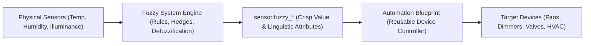

# Blueprint Guide: Automating with Fuzzy System

This guide explains how to design, install, and use **Home Assistant Blueprints** with the **Fuzzy System** integration. Blueprints allow you to package and share reusable automations that translate fuzzy inference outputs into physical actions (fans, dimmers, valves, thermostats, and notifications).

---

## 1. Architectural Philosophy: Separation of Concerns

Home Assistant blueprints create **Automations** and **Scripts**. They do not create underlying calculation engines or helper entities.

When building smart automations, the optimal design pattern is **Separation of Concerns**:



1. **Fuzzy System**: Handles the mathematical reasoning, multi-input synthesis, membership curves, and defuzzification locally and deterministically.
2. **Blueprint Automation**: Handles the physical device logic, minimum stall speeds, mode cutoffs, and device-specific service calls.

This architecture ensures that your fuzzy rules remain independent of whether a specific room has a Sonoff fan, a Philips Hue dimmer, or a Zigbee radiator valve.

---

## 2. Idiosyncrasies & Special Considerations for Fuzzy System

When authoring blueprints that interact with `fuzzy_system`, keep these integration-specific behaviors in mind:

### A. Crisp State vs. Linguistic Attributes
Every output sensor (`sensor.fuzzy_<system_id>_<output_name>`) provides two levels of data:
* **The Main State (`trigger.to_state.state`)**: The crisp, defuzzified numerical value (e.g. `14.805` or `62.4%`).
* **Attributes**:
  * `term_memberships`: A dictionary of membership degrees across each linguistic set:
    ```jinja2
    {{ state_attr('sensor.fuzzy_comfort_fan_speed', 'term_memberships')['high'] }}
    ```
  * `rule_strengths`: A list of rules and their evaluated firing strengths:
    ```jinja2
    {{ state_attr('sensor.fuzzy_comfort_fan_speed', 'rule_strengths') }}
    ```

### B. Boot Latency & Unavailable States
During Home Assistant startup or when physical wireless sensors temporarily drop off mesh networks, fuzzy sensors may hold an `unknown` or `unavailable` state. Always guard your blueprint triggers against non-numeric states:
```yaml
condition:
  - condition: template
    value_template: >
      {{ trigger.to_state.state not in ['unknown', 'unavailable'] and trigger.to_state.state | float(none) is not none }}
```

### C. Integer Conversion & Device Limits
Fuzzy defuzzification produces high-precision floating-point numbers (e.g., `42.6734`). Physical device services (such as `fan.set_percentage` or `light.turn_on` with `brightness_pct`) usually expect an **integer between 0 and 100**.
Always round and cast inside your blueprint actions:
```yaml
data:
  percentage: "{{ trigger.to_state.state | float | round(0) | int }}"
```

### D. Motor Stall & Bulb Flicker Protection
At very low percentages (e.g., `1%` to `8%`), AC fans can hum and stall, and LED dimmers can flicker. Provide a low cutoff threshold (turning the device completely off) and a minimum on-speed (e.g., `10%` minimum) in the blueprint configuration.

---

## 3. How to Install Blueprints

### Method 1: Using "My Home Assistant" (Recommended for Users)
If the blueprint is hosted on GitHub, users can import it with a single click:
1. Open the [Home Assistant Blueprint Import](https://my.home-assistant.io/redirect/blueprint_import/) page.
2. Enter the raw URL of the blueprint YAML file.
3. Click **Preview** and then **Import Blueprint**.

### Method 2: Home Assistant Web UI
1. Navigate to **Settings > Automations & Scenes > Blueprints**.
2. Click **Import Blueprint** in the bottom-right corner.
3. Paste the GitHub link to the blueprint file:
   ```text
   https://github.com/dougransom/fuzzy_system/blob/main/blueprints/automation/fuzzy_system/fuzzy_actuator_controller.yaml
   ```
4. Click **Import**.

### Method 3: Manual Installation (For Local Development)
Place the blueprint YAML file in your Home Assistant configuration directory under:
```text
config/blueprints/automation/fuzzy_system/<blueprint_name>.yaml
```
Then reload blueprints via **Developer Tools > YAML > Blueprints**.

---

## 4. Reusable Blueprint Templates

### Blueprint 1: Continuous Actuator Controller (Turnkey)
*(Bundled in the repository at [`blueprints/automation/fuzzy_system/fuzzy_actuator_controller.yaml`](../blueprints/automation/fuzzy_system/fuzzy_actuator_controller.yaml))*

This blueprint connects any fuzzy output sensor to a physical Fan or Light Dimmer with stall protection:

```yaml
blueprint:
  name: "Fuzzy System: Continuous Actuator Controller"
  description: "Drives fans or dimmers from a Fuzzy System output sensor."
  domain: automation
  input:
    fuzzy_sensor:
      name: Fuzzy Output Sensor
      selector:
        entity:
          domain: sensor
    target_entity:
      name: Target Actuator
      selector:
        target:
          entity:
            domain: [fan, light]
    cutoff_threshold:
      name: Low Cutoff Threshold (%)
      default: 2.0
      selector:
        number:
          min: 0
          max: 20
          step: 0.5
          unit_of_measurement: "%"
    min_on_speed:
      name: Minimum On Speed (%)
      default: 10
      selector:
        number:
          min: 5
          max: 30
          step: 1
          unit_of_measurement: "%"

mode: restart
max_exceeded: silent

trigger:
  - platform: state
    entity_id: !input fuzzy_sensor

condition:
  - condition: template
    value_template: >
      {{ trigger.to_state.state not in ['unknown', 'unavailable'] and trigger.to_state.state | float(none) is not none }}

variables:
  cutoff: !input cutoff_threshold
  min_speed: !input min_on_speed
  raw_value: "{{ trigger.to_state.state | float(0) }}"
  target: !input target_entity

action:
  - choose:
      - conditions:
          - condition: template
            value_template: "{{ raw_value <= cutoff }}"
        sequence:
          - service: homeassistant.turn_off
            target: !input target_entity
    default:
      - variables:
          clamped_pct: "{{ [raw_value, min_speed] | max | round(0) | int }}"
      - choose:
          - conditions:
              - condition: template
                value_template: "{{ 'fan' in (target.get('entity_id') | string) }}"
            sequence:
              - service: fan.set_percentage
                target: !input target_entity
                data:
                  percentage: "{{ clamped_pct }}"
        default:
          - service: light.turn_on
            target: !input target_entity
            data:
              brightness_pct: "{{ clamped_pct }}"
```

---

### Blueprint 2: Linguistic State Alert / Mode Trigger
Because Fuzzy System exposes linguistic set memberships, blueprints can trigger notifications or mode changes when a fuzzy concept (like `"humid"` or `"extremely cold"`) surpasses an activation threshold:

```yaml
blueprint:
  name: "Fuzzy System: Linguistic Term Trigger"
  description: "Triggers an action when a specific linguistic term membership exceeds a threshold."
  domain: automation
  input:
    fuzzy_sensor:
      name: Fuzzy Output Sensor
      selector:
        entity:
          domain: sensor
    linguistic_term:
      name: Target Linguistic Term
      description: "e.g. 'hot', 'critical', 'generous'"
      selector:
        text:
    activation_threshold:
      name: Membership Activation Threshold
      default: 0.7
      selector:
        number:
          min: 0.1
          max: 1.0
          step: 0.05
    actions_to_run:
      name: Action Sequence
      selector:
        action:

trigger:
  - platform: state
    entity_id: !input fuzzy_sensor

condition:
  - condition: template
    value_template: >
      
      
      {{ memberships.get(term, 0.0) | float >= !input activation_threshold }}

action: !input actions_to_run
```

---

### Blueprint 3: Dynamic On-Demand Evaluation via `response_variable`
For automations that only run periodically (e.g. watering plants once a day at 06:00), you do not need a constantly running sensor. Blueprints can invoke the **`fuzzy_system.simulate`** service dynamically:

```yaml
action:
  - service: fuzzy_system.simulate
    data:
      system_id: garden_irrigation
      inputs:
        soil_moisture: "{{ states('sensor.soil_moisture') | float }}"
        forecast_rain: "{{ states('sensor.weather_expected_rain') | float }}"
    response_variable: eval_result

  - service: valve.open_valve
    target:
      entity_id: valve.garden_zone_1
  
  - delay:
      # Calculate open duration in minutes based on fuzzy output
      minutes: "{{ eval_result.outputs.watering_duration.value | round(0) | int }}"
      
  - service: valve.close_valve
    target:
      entity_id: valve.garden_zone_1
```
