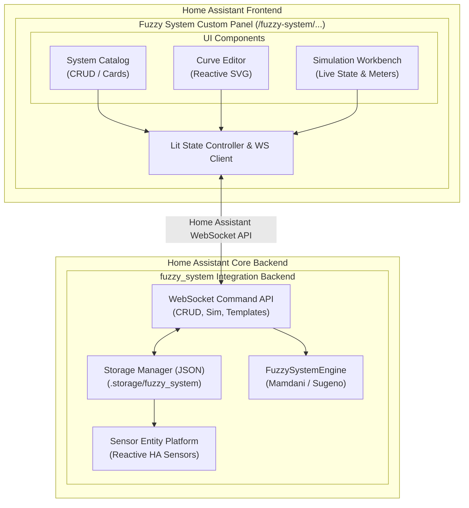

# Fuzzy System: Frontend Architecture & Technology Blueprint

## 1. Architecture Overview & Topology

Building an enterprise-grade visual configuration editor inside Home Assistant requires strict alignment with Home Assistant's frontend ecosystem. The frontend must feel like a native, seamless part of the Home Assistant user interface while providing advanced, responsive graphics for membership curves and real-time simulation.



---

## 2. Integration Modes: Custom Panel vs Options Flow vs Lovelace Card

Three potential UI hosting models exist within Home Assistant. An optimal strategy uses a **hybrid approach**:

| UI Hosting Strategy | Role in Fuzzy System | Implementation Rationale |
| :--- | :--- | :--- |
| **Custom Panel (`ha-panel`)** | **Primary Full Workbench** (Recommended) | The configuration of multi-variable universes, interactive curves, multi-rule DNF trees, and live simulation sandboxes requires full-screen real estate that cannot fit comfortably into a modal dialogue. A custom panel registered at `/fuzzy-system` provides unrestricted layout flexibility. |
| **Config / Options Flow** | **Onboarding & Quick Links** | The entry point in `Settings > Devices & Services > Fuzzy System` provides options to "Open Visual Editor" (redirecting to the panel) or import existing YAML definitions. |
| **Custom Lovelace Card** | **Dashboard Telemetry & Monitoring** | A companion custom card (`fuzzy-system-card`) that can be added to standard dashboards to visualize live sensor curves, active rule firing, and dominant linguistic terms during daily operation. |

---

## 3. Frontend Technology Stack & Tooling

To ensure zero conflict with Home Assistant core and guarantee forward compatibility:

1. **Component Framework: LitElement (`lit`)**
   - Home Assistant's entire modern frontend is built on **Lit** (Web Components with reactive properties and shadow DOM encapsulation).
   - Using Lit ensures 100% style isolation and direct interoperability with Home Assistant custom elements (`ha-card`, `ha-entity-picker`, etc.).
2. **Language: TypeScript**
   - Strict typing across all fuzzy data models (Universes, Terms, Antecedent Groups, Consequents, Firing Strengths).
   - Generates clean JavaScript ES modules.
3. **Bundler & Build Pipeline: Vite**
   - High-speed ESM bundling targeting modern browsers.
   - Outputs a single distribution file: `custom_components/fuzzy_system/frontend/dist/fuzzy-system-panel.js`.
   - Generates content hashes or version query parameters for seamless cache busting upon integration updates.
4. **State Management: Reactive Controller Pattern**
   - Utilizes Lit's `ReactiveController` interface for orchestrating WebSocket communication, optimistic UI updates, and dirty-state tracking.
   - Avoids heavy external stores (Redux, MobX), keeping bundle size under 120 KB gzipped.

---

## 4. Reusable Home Assistant Frontend Components

Home Assistant exports a wide catalog of custom web components in its frontend runtime (`hass`). The Fuzzy System UI will leverage these native components directly, inheriting automatic theming, accessibility, and locale handling:

| Native HA Element | Usage in Fuzzy System UI | Functionality |
| :--- | :--- | :--- |
| `ha-card` | System overview, editor panels, simulation cards | Standard surface with theme elevation and borders. |
| `ha-entity-picker` | Input Variable Entity Binding | Filterable selector restricted to numeric sensors, input numbers, climate attributes. |
| `ha-icon-picker` | Output Variable Icon Selector | Searchable Material Design Icons picker. |
| `ha-textfield` | Ranges, parameter values, term names | Themed floating-label numeric and text inputs. |
| `ha-select` / `ha-combo-box` | Engine types, defuzzifiers, hedges | Form dropdowns styled according to HA guidelines. |
| `ha-slider` | Simulation inputs, universe resolution | Native smooth sliders with track and value pins. |
| `ha-switch` | Live sync toggle, status sensor toggle | Standard boolean toggles. |
| `ha-button` / `ha-icon-button` | Actions, Add/Remove, Save, Reload | Accessible buttons styled for primary, secondary, and destructive actions. |
| `ha-dialog` | Delete confirmations, template selection | Native modal dialogs. |
| `ha-alert` | Syntax warnings, validation errors, notices | Color-coded alert bars (info, warning, error, success). |
| `ha-code-editor` | Linguistic DSL rule editor, YAML export | CodeMirror-based syntax editor with syntax highlighting. |
| `ha-svg-icon` | Standard Home Assistant UI icons | Crisp vector icons. |
| `mwc-tab` / `mwc-tab-bar` | Editor navigation between tabs | Material design tab bar for Inputs, Outputs, Rules, Simulation. |

---

## 5. Data Visualization Engine: Interactive Curve Editor

A core requirement is real-time visualization and interactive editing of membership curves ($[0.0, 1.0]$ membership vs universe $x$).

### Decision: Custom Reactive SVG over External Chart Libraries
- **Why NOT heavy charting libraries (Chart.js, Plotly, Highcharts)?**
  - High bundle weight (often 300KB–1MB+).
  - Difficult to implement two-way vertex drag-and-drop handles on top of pre-rendered canvases.
  - Fragile integration with Home Assistant dynamic dark/light CSS variables.
- **Why Reactive SVG via Lit?**
  - **Zero extra dependencies**: Pure SVG primitives (`<path>`, `<circle>`, `<polygon>`, `<text>`) generated via Lit's `svg` template tag.
  - **Direct Two-Way Binding**: Anchor vertices (e.g., points $a, b, c$ for `trimf`) are rendered as `<circle class="handle">` elements. Direct pointer event listeners (`pointerdown`, `pointermove`, `pointerup`) update component state with immediate reactive redraw.
  - **Dynamic Theme Synchronization**: SVGs reference Home Assistant CSS variables directly (`var(--primary-color)`, `var(--accent-color)`).
  - **Responsive Vector Scaling**: Uses standard SVG `viewBox="0 0 1000 400"` with `preserveAspectRatio="none"` or uniform scaling, adapting effortlessly to desktop screens, tablets, and phones.

### Mathematical Rendering Implementations
1. **Triangular (`trimf`, params $[a, b, c]$)**:
   - Path: `M ${x(a)},${y(0)} L ${x(b)},${y(1)} L ${x(c)},${y(0)}`
2. **Trapezoidal (`trapmf`, params $[a, b, c, d]$)**:
   - Path: `M ${x(a)},${y(0)} L ${x(b)},${y(1)} L ${x(c)},${y(1)} L ${x(d)},${y(0)}`
3. **Gaussian (`gaussmf`, params $[\mu, \sigma]$)**:
   - Evaluated across $N=100$ equidistant points: $f(x) = \exp\left(-\frac{(x - \mu)^2}{2\sigma^2}\right)$. Rendered via SVG path `d="M ... L ... L ..."`.
4. **Sigmoidal (`sigmf`, params $[b, c]$)**:
   - $f(x) = \frac{1}{1 + \exp(-b(x - c))}$.
5. **Generalized Bell (`gbellmf`, params $[a, b, c]$)**:
   - $f(x) = \frac{1}{1 + \left|\frac{x - c}{a}\right|^{2b}}$.
6. **Hedge Application**:
   - The SVG engine applies the hedge exponent directly to the vertical coordinate $y$: $y' = y_{scale}((\mu(x))^p)$, displaying the concentrated or dilated curve instantly.

---

## 6. Theming, Styling & Accessibility

1. **Design Tokens & CSS Variables**:
   All UI styling strictly derives from Home Assistant CSS variables:
   ```css
   :host {
     --fuzzy-curve-1: var(--primary-color, #03a9f4);
     --fuzzy-curve-2: var(--accent-color, #ff9800);
     --fuzzy-curve-3: var(--success-color, #4caf50);
     --fuzzy-curve-4: var(--warning-color, #f44336);
     --fuzzy-curve-5: #9c27b0;
     --fuzzy-grid-color: var(--divider-color, rgba(0, 0, 0, 0.12));
     --fuzzy-surface: var(--card-background-color, #fff);
     --fuzzy-text: var(--primary-text-color, #212121);
   }
   ```
2. **Dark Mode Support**:
   - Automatic adaptation when the user or system switches to dark theme.
   - SVG grid lines, canvas background, and handle contrasts automatically adjust.
3. **Accessibility (a11y)**:
   - Keyboard accessible: All vertex handles support arrow key nudging (Step: 1% with Shift: 10%).
   - Screen-reader labels (`aria-label`) on all inputs and handles.
   - Visual focus rings matching Home Assistant core styling.

---

## 7. Panel Registration & Backend Serving Architecture

1. **Static Asset Registration**:
   - The integration registers its compiled frontend assets during `async_setup` using `hass.http.register_static_path`:
     ```python
     await hass.http.async_register_static_paths([
         StaticPathConfig("/fuzzy_system_frontend", hass.config.path("custom_components/fuzzy_system/frontend/dist"), cache_headers=True)
     ])
     ```
2. **Panel Registration**:
   - The panel is registered via `frontend.async_register_built_in_panel`:
     - Component name: `fuzzy-system-panel`
     - URL path: `fuzzy-system`
     - Sidebar icon: `mdi:chart-bell-curve-cumulative` or `mdi:brain`
     - Title: "Fuzzy Systems"
     - Require admin: Configurable (default: true for editing, false for read-only view).
3. **Cache Busting**:
   - Injected panel URL includes the integration version from `manifest.json`:
     `/fuzzy_system_frontend/fuzzy-system-panel.js?v=0.0.2`.
