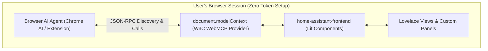

# RFC / Proposal: Expose WebMCP (document.modelContext) in the Frontend for Browser-Native AI Agents

## Context & Motivation
Home Assistant has made tremendous architectural strides with AI and Large Language Models, particularly with the new **LLM Tool Platform** ([ADR #1412](https://github.com/home-assistant/architecture/discussions/1412)) and the addition of **OAuth 2.0 / PKCE metadata for Server-Side Model Context Protocol (MCP)** ([Discussions #1332 & #1333](https://github.com/home-assistant/architecture/discussions/1332)).

Currently, this infrastructure is entirely **backend/Python-centric**. For an AI agent (such as Claude Desktop, ChatGPT, or Cursor) to interact with Home Assistant, the user must:
1. Generate a Long-Lived Access Token.
2. Configure network URLs, proxies, or Nabu Casa endpoints.
3. Manage external client configuration files.

While Server MCP is essential for 24/7 headless background automations, it cannot interact with the **active visual UI**, uncommitted form states, or in-browser AI assistants. Today, browser agents attempting to interact with Home Assistant must resort to brittle visual screenshotting or raw DOM scraping.

---

## Proposal: WebMCP in `home-assistant-frontend`
We propose introducing support for **WebMCP** (the emerging W3C standard for exposing structured tools from web apps to browser agents via `document.modelContext`) into the Home Assistant frontend.

With WebMCP, Home Assistant's Lit frontend and custom panels can declaratively register tools that browser-embedded AI agents (such as Chrome's built-in `window.ai` / Gemini Nano, browser extensions, or subagents) can discover and call directly.

---

## Why WebMCP Complements (Rather Than Replaces) Server MCP

1. **Zero Configuration & Zero Auth Overhead**:
   WebMCP operates inside the user's **existing authenticated web session**. Non-technical users do not need to create tokens, configure servers, or set up port forwarding. An in-browser assistant can immediately interact with Home Assistant safely.
2. **Access to Uncommitted / In-Memory State**:
   Server MCP can only see what is already saved in SQLite / config entries. WebMCP can inspect and validate in-progress form edits, dashboard draft layouts, or visual controls before the user commits them.
3. **Interactive Human-in-the-Loop Collaboration**:
   A browser agent can actively drive the UI alongside the human—opening dialogs, switching views, or highlighting specific elements to explain actions visually.
4. **On-Device Local Privacy**:
   Browser-native LLMs (like Chrome's built-in Gemini Nano via `window.ai`) can run simulations, summarize dashboard status, and validate automations entirely on the client's local GPU/NPU without sending smart home data over the internet.

---

## Proposed Core Tool Capabilities
The frontend could initially expose lightweight, high-value tools on `document.modelContext`:
* `ha.get_current_view`: Inspect the active dashboard URL, view path, and visible card entities.
* `ha.navigate`: Switch tabs, navigate to areas, or open device controls.
* `ha.add_card_to_dashboard`: Programmatically stage or insert a Lovelace card YAML into a view.
* `ha.trigger_dialog`: Open the "More Info" dialog for a specific entity.

In addition, custom panels and custom cards could dynamically register domain-specific tools into the model context.

---

## Working Proof-of-Concept
We recently implemented a working proof-of-concept of this dual architecture in the [`fuzzy_system`](https://github.com/dougransom/fuzzy_system) custom component:
* **Server MCP**: Provides Home Assistant services (`fuzzy_system.simulate`, `fuzzy_system.generate_card`) for external IDE and headless agents.
* **WebMCP (`document.modelContext`)**: The custom Lit frontend registers tools allowing browser agents to inspect visual membership curves, run dry-run simulations, and trigger 1-click dashboard card synthesis right inside the UI.

---

## Questions for the Architecture Team
1. Would the frontend team prefer `document.modelContext` to be managed centrally in `home-assistant-frontend`, or exposed via a modular mixin for Lovelace views and panels?
2. What permission or confirmation model should be required before a browser agent modifies dashboard layouts?
3. How should custom card and panel developers register domain-specific tools into the shared model context?
