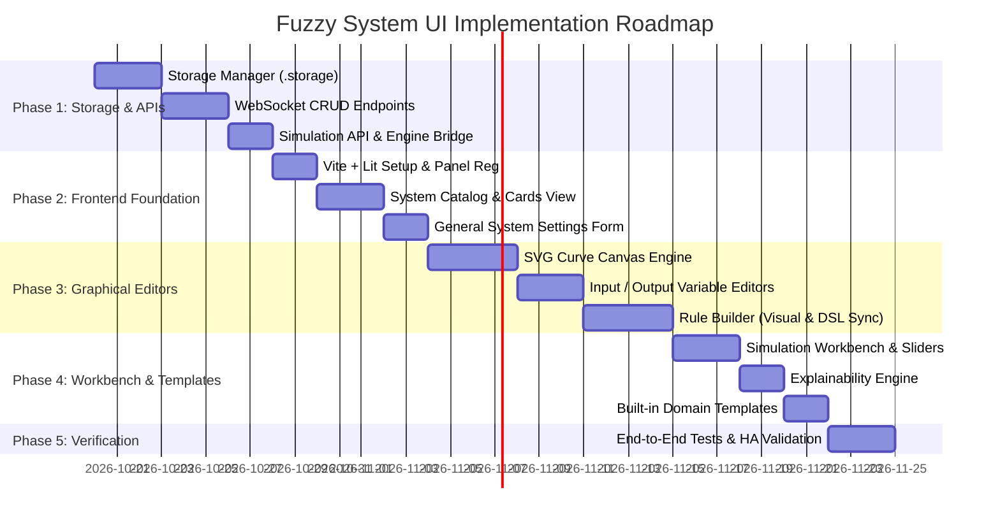

# Fuzzy System: Visual Configuration UI Implementation Plan

## 1. Project Overview & Architecture Objectives

This implementation plan outlines the engineering roadmap to introduce a full visual configuration UI, interactive curve editor, linguistic rule builder, and live simulation workbench to the `fuzzy_system` Home Assistant integration.

### Core Architecture Goals:
1. **Zero-Breaking-Change Coexistence**: Existing YAML configurations in `configuration.yaml` remain fully supported and locked as read-only in the UI.
2. **First-Class UI Management**: Systems configured via the UI are persisted as individual Home Assistant Config Entries (`config_entries.ConfigEntry`), giving them native integration with Home Assistant's Helper registry, entity registry, and device/service management.
3. **Reactive Sensor Reconciliation**: Output entities (`sensor.fuzzy_<system>_<output>`, `_set`, and status sensors) are dynamically added, updated, or removed when Config Entries are modified in the UI.
4. **WebSocket-Driven Simulation & Management**: High-performance backend endpoints for dry-run evaluations, explainability diagnostics, and Config Entry orchestration.
5. **Companion Lovelace Card**: Standalone dashboard card (`fuzzy-system-card`) included in the frontend build for live operational monitoring.
6. **Recurrent Feedback & Stability Protection**: Native support for recurrence relations where outputs feed back into inputs (direct or indirect). Dual protection prevents runaway cascades and micro-jitter:
   - Configurable update rate limiting (`max_updates_per_period` [default 20] per `update_period` [default 0.05s]).
   - Output convergence threshold / deadband (`epsilon` [default 0.01]) that suppresses state commits when changes are smaller than $\epsilon$, allowing recurrent feedback loops to stably converge without triggering endless re-evaluations.

---

## 2. Likely Files Requiring Modification & Creation

### 2.1. Existing Integration Files Requiring Modification
- `custom_components/fuzzy_system/__init__.py`:
  - Register static asset paths for the compiled frontend panel and Lovelace card.
  - Register the custom panel (`frontend.async_register_built_in_panel`) with `require_admin=True`.
  - Coordinate dynamic platform setup for both YAML-configured and ConfigEntry-configured systems.
  - Register custom WebSocket commands (enforcing admin permissions).
  - Update schema validation for `max_updates_per_period`, `update_period`, and per-output `epsilon`.
- `custom_components/fuzzy_system/const.py`:
  - Add WebSocket command identifiers (`WS_TYPE_LIST_SYSTEMS`, `WS_TYPE_SAVE_SYSTEM`, `WS_TYPE_SIMULATE`, etc.).
  - Add frontend asset constants, URLs, and card custom element names.
  - Add configuration keys and defaults: `CONF_MAX_UPDATES_PER_PERIOD` (20), `CONF_UPDATE_PERIOD` (0.05s), `CONF_EPSILON` (0.01).
- `custom_components/fuzzy_system/config_flow.py`:
  - Upgrade config flow to handle multi-entry creation and options flow for fuzzy systems.
  - Provide direct deep-link redirects to the visual editor (`/fuzzy-system?entry_id=...`).
- `custom_components/fuzzy_system/sensor.py`:
  - Support dynamic entity addition and removal via `async_setup_entry` / entity platform callbacks.
  - Refactor listener registrations so updating a system cleans up old listeners and re-binds cleanly.
  - Implement system-level sliding-window rate limiter (`max_updates_per_period` within `update_period`).
  - Implement output deadband convergence check (`abs(new_value - prev_value) < epsilon` suppresses `async_write_ha_state()`).
  - Update system status sensor to reflect throttling state (`RUNAWAY_THROTTLED`) if rate limit is exceeded.
- `custom_components/fuzzy_system/fuzzy_engine.py`:
  - Add dictionary serialization and deserialization methods (`to_dict()` and `from_dict()`).
  - Add rule parser introspection methods (exporting AST for the visual builder and compiling from AST).
  - Add an isolated evaluation helper for dry-run simulation that does not mutate sensor states.
- `custom_components/fuzzy_system/manifest.json`:
  - Maintain `requirements: ["scikit-fuzzy==0.5.0"]` to prevent version locking conflicts with other integrations.
- `pyproject.toml`:
  - Add `scipy` to dependencies/test-dependencies for local developer testing.

### 2.2. New Backend Files to Create
- `custom_components/fuzzy_system/websocket.py`:
  - WebSocket API handlers registered with `@websocket_api.websocket_command` and `@websocket_api.require_admin`.
  - Bridges the visual editor to `hass.config_entries` (adding, updating, removing entries) and executes dry-run simulations.
- `custom_components/fuzzy_system/templates.py`:
  - Preset library defining starter systems (Fan, Ventilation, Irrigation, Solar Diversion).

### 2.3. New Frontend Files to Create (Vite + TypeScript + Lit Project)
```
custom_components/fuzzy_system/frontend/
├── package.json
├── tsconfig.json
├── vite.config.ts
├── src/
│   ├── fuzzy-system-panel.ts         # Main panel entrypoint (/fuzzy-system)
│   ├── fuzzy-system-card.ts          # Lovelace dashboard companion card
│   ├── types.ts                      # TypeScript interfaces (System, Variable, Term, Rule)
│   ├── api/
│   │   └── websocket.ts              # HA WebSocket client helpers
│   ├── components/
│   │   ├── system-catalog.ts         # Grid of system cards (YAML vs UI badges)
│   │   ├── system-editor.ts          # Main tabbed editor container
│   │   ├── variable-editor.ts        # Input & Output variable settings
│   │   ├── curve-canvas.ts           # Interactive reactive SVG membership editor (piecewise drag + sliders)
│   │   ├── rule-builder.ts           # Visual DNF antecedent block builder (AND/OR)
│   │   ├── rule-dsl-editor.ts        # Bidirectional text rule editor
│   │   ├── simulation-workbench.ts   # Interactive test sliders & explainability
│   │   └── template-modal.ts         # Preset template picker
│   └── styles/
│       └── shared-styles.ts          # HA CSS custom properties & theme tokens
└── dist/
    ├── fuzzy-system-panel.js         # Compiled standalone ES bundle (committed to Git)
    └── fuzzy-system-card.js          # Compiled Lovelace card (committed to Git)
```

---

## 3. Backend APIs & WebSocket Endpoints

All frontend-backend communication will use Home Assistant's native, authenticated WebSocket protocol (`hass.callWS`) with admin enforcement (`require_admin=True`).

### 3.1. Systems Management Endpoints
1. **`fuzzy_system/systems/list`**:
   - **Direction**: Frontend $\rightarrow$ Backend
   - **Response**: Array of all configured systems, indicating source (`yaml` vs `config_entry`), engine type, variable counts, and rule counts.
2. **`fuzzy_system/systems/get`**:
   - **Params**: `{ "system_id": "living_room" }` or `{ "entry_id": "..." }`
   - **Response**: Full system definition (engine type, defuzzifier, inputs, outputs, rules).
3. **`fuzzy_system/systems/save`**:
   - **Params**: Full system dictionary schema.
   - **Behavior**: Validates with Voluptuous, checks for YAML ID collisions, creates or updates the corresponding `ConfigEntry`, hot-reloads the engine and sensors, and returns the updated entry.
4. **`fuzzy_system/systems/delete`**:
   - **Params**: `{ "entry_id": "..." }`
   - **Behavior**: Calls `hass.config_entries.async_remove`, unregistering entities and cleaning up event listeners.

### 3.2. Simulation & Diagnostics Endpoints
1. **`fuzzy_system/simulate`**:
   - **Params**:
     - `system_config`: Transient or persisted system definition.
     - `inputs`: Dictionary of scalar test values (e.g., `{"temperature": 24.5, "humidity": 65.0}`).
   - **Response**:
     - `defuzzified_values`: Crisp output values per variable.
     - `dominant_terms`: Winning linguistic terms.
     - `term_activations`: Activation heights per term.
     - `term_memberships`: Membership values of crisp outputs.
     - `rule_strengths`: Array of `{ rule, firing_strength, bottleneck_clause }`.
     - `aggregated_sets`: Sampled curve arrays for visualization.
     - `explainability`: Generated natural-language summary.

### 3.3. Templates Endpoints
1. **`fuzzy_system/templates/list`**:
   - Returns metadata and descriptions for all built-in templates.
2. **`fuzzy_system/templates/instantiate`**:
   - Generates a fresh, unique system configuration from a selected template.

---

## 4. Migration & Coexistence Strategy

Maintaining seamless backward compatibility with existing YAML configurations is mandatory.

### 4.1. The Dual-Source Model
- Systems are tagged with a source origin:
  - **`source: "yaml"`**: Read-only in the UI. Displayed with a lock icon and a "Clone to UI" action.
  - **`source: "config_entry"`**: Fully editable, deletable, and stored as native Home Assistant Config Entries.
- Name collisions between YAML and Config Entries:
  - If a system with ID `climate` exists in YAML, YAML takes precedence and locks the ID. Saving a new UI system with ID `climate` is blocked with a validation alert to prevent duplicate entity IDs.

### 4.2. Entity Unique ID Stability
- Entity unique IDs are constructed predictably:
  - `fuzzy_<system_id>_<output_var>`
  - `fuzzy_<system_id>_<output_var>_set`
  - `fuzzy_<system_id>_status`
- Migrating a YAML system to a UI-managed system will preserve these exact unique IDs, preventing broken automations, scripts, or Lovelace cards in the user's dashboard.

---

## 5. Performance Risks & Mitigation Strategies

| Performance Risk | Severity | Mitigation Strategy |
| :--- | :--- | :--- |
| **High Discourse Resolution Serialization** | Medium | When universe resolution is high ($N=500+$), sending raw numpy arrays across WebSocket introduces JSON serialization latency. **Mitigation**: Curve parameters (e.g., $[a, b, c]$ for triangles) are sent to the frontend; the frontend computes display SVG points locally using vector math, transmitting raw arrays only during aggregated simulation. |
| **Simulation Slider Lag (WebSocket Flooding)** | Medium | Rapidly dragging an input slider could generate dozens of WebSocket simulation calls per second. **Mitigation**: Frontend debounce/throttle (e.g., 50ms) with request cancellation if a newer simulation frame is queued. |
| **Entity State Tracking Overhead** | Low | Many input entities could trigger frequent evaluations. **Mitigation**: The engine already executes in milliseconds. We ensure entity state listeners skip evaluation if state change is non-numeric or identical to previous value (`old_state.state == new_state.state`). |
| **Frontend Bundle Size Impact** | Low | Heavy chart dependencies can slow initial HA page load. **Mitigation**: Using Lit-based reactive SVGs instead of Chart.js/Plotly keeps the total compiled bundle under 120 KB, loaded asynchronously on demand only when opening the panel. |

---

## 6. Phased Implementation Roadmap



### Detailed Phase Milestones:
- **Phase 1: Config Entry Lifecycle & WebSocket Infrastructure** ✅ (Completed)
  - Refactor config flow to support multi-entry CRUD with `config_entries.ConfigEntry`.
  - Implement `websocket.py` with Voluptuous validation for CRUD and simulation (`require_admin=True`).
  - Test dynamic entity registration and deletion without restart.
- **Phase 2: Frontend Shell & System Catalog** ✅ (Completed)
  - Set up Vite + TypeScript build in `custom_components/fuzzy_system/frontend/`.
  - Implement panel registration via `__init__.py` with `require_admin=True` and mtime cache busting.
  - Build System Overview with system cards, status badges, deletion modals, live reactive output sensors, and entity picker.
  - Built guided Visual Rule Builder with antecedent hedges and live syntax preview.
- **Phase 3: Graphical Variable & Membership Curve Canvas** ✅ (Completed)
  - Built interactive Lit SVG membership curve canvas component (`<fuzzy-curve-canvas>`) rendering vector curves for `trimf`, `trapmf`, `gaussmf`, `sigmf`, `gbellmf`, and `singleton/constant`.
  - Embedded SVG curve previews in both Input Antecedents and Output Consequents tabs with synchronized live sensor value indicators.
  - Implemented real-time term parameters editor with synchronized numerical inputs and curve redrawing.
- **Phase 4: Simulation Workbench, Live Aggregated Set Visualization & Lovelace Card** ✅ (Completed)
  - **Live Aggregated Fuzzy Set Graph**: Real-time shaded distribution plot (`<fuzzy-aggregated-graph>`) of the aggregated fuzzy set ($x \in \text{universe}, y = \mu(x)$) with glowing vertical defuzzification slice line (centroid, bisector, etc.) and dominant linguistic set badge.
  - **Expandable Live Waveform Drawer**: Added expandable live waveform drawer on catalog cards (`📈 Graph`) to monitor active controller output distributions directly on `/fuzzy-system` in real time.
  - **Simulation Workbench**: Built dedicated `🧪 Simulation & Waveforms` tab with antecedent sliders, Home Assistant live state sync ("⚡ Sync Live Sensor Values"), real-time term activation previews, interactive defuzzification plots, and rule firing breakdown with bottleneck bars.
  - **Lovelace Companion Card**: Custom dashboard card (`<fuzzy-system-card>`) bundled into the frontend and registered in `window.customCards` for Lovelace dashboards.
- **Phase 5: Quality Assurance, Documentation & Release Prep** ✅ (Completed)
  - All 45 backend unit/integration tests passing (`uv run pytest tests`).
  - Zero lint/type errors (`uv run ruff check`).
  - Visual card editor (`fuzzy-system-card-editor`) built with system auto-discovery and display toggles.
  - Frontend compiled clean with Vite (167 KB, 36 KB gzipped) and pre-built bundle committed for zero-build HACS installation.
  - Manifest and pyproject versions synchronized to `0.1.0`.
  - Comprehensive documentation and Mermaid architecture diagrams published in `README.md`.
