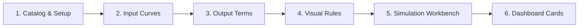
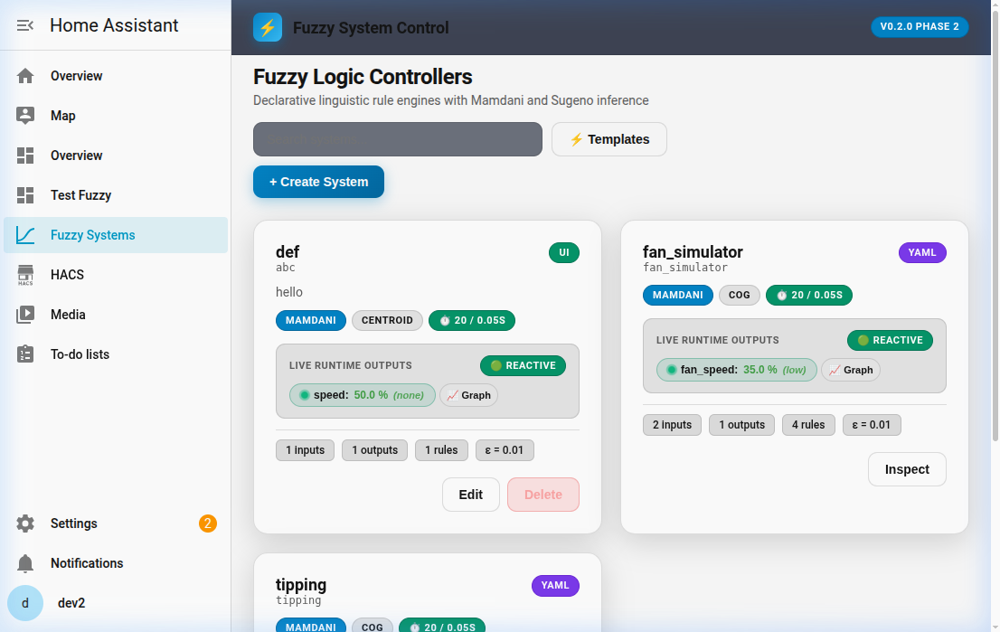
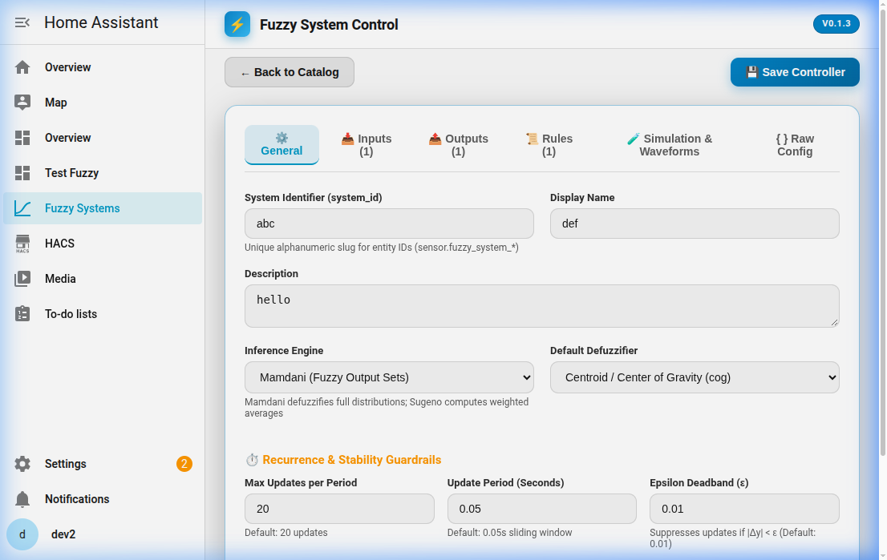
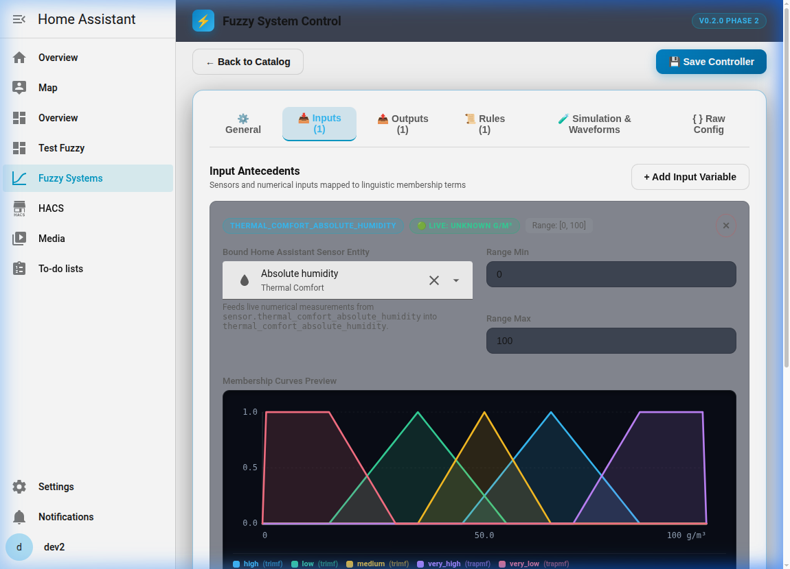
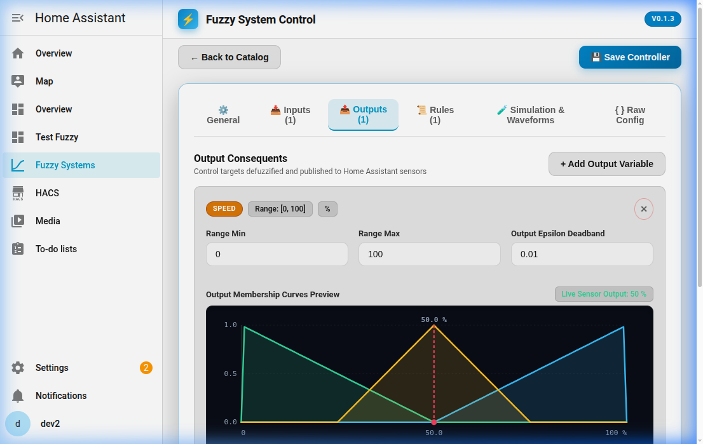
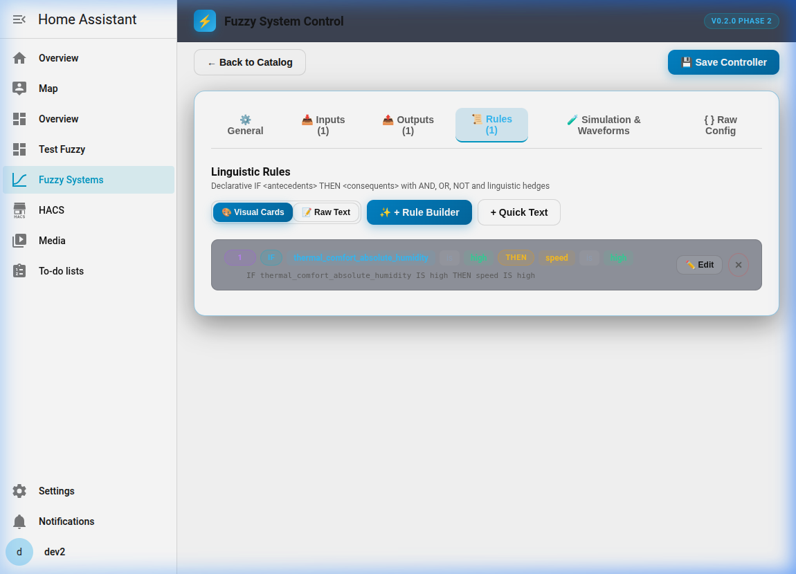
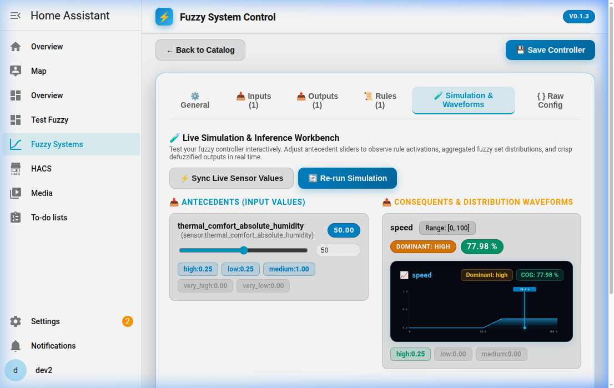
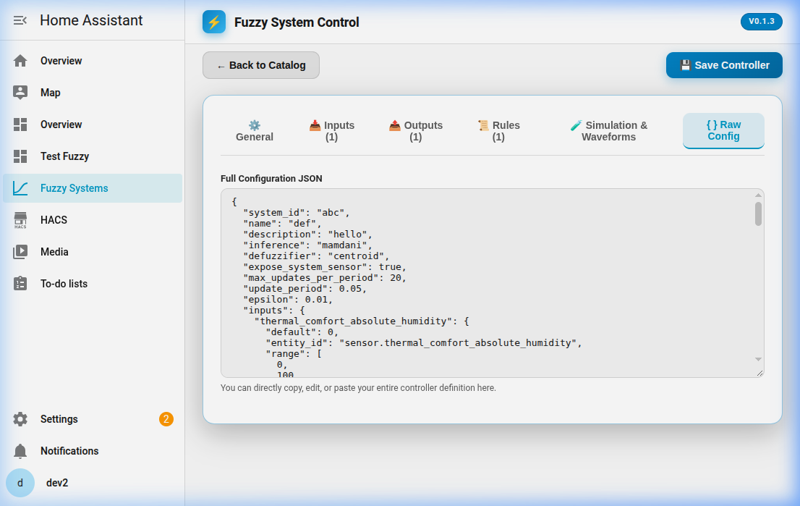
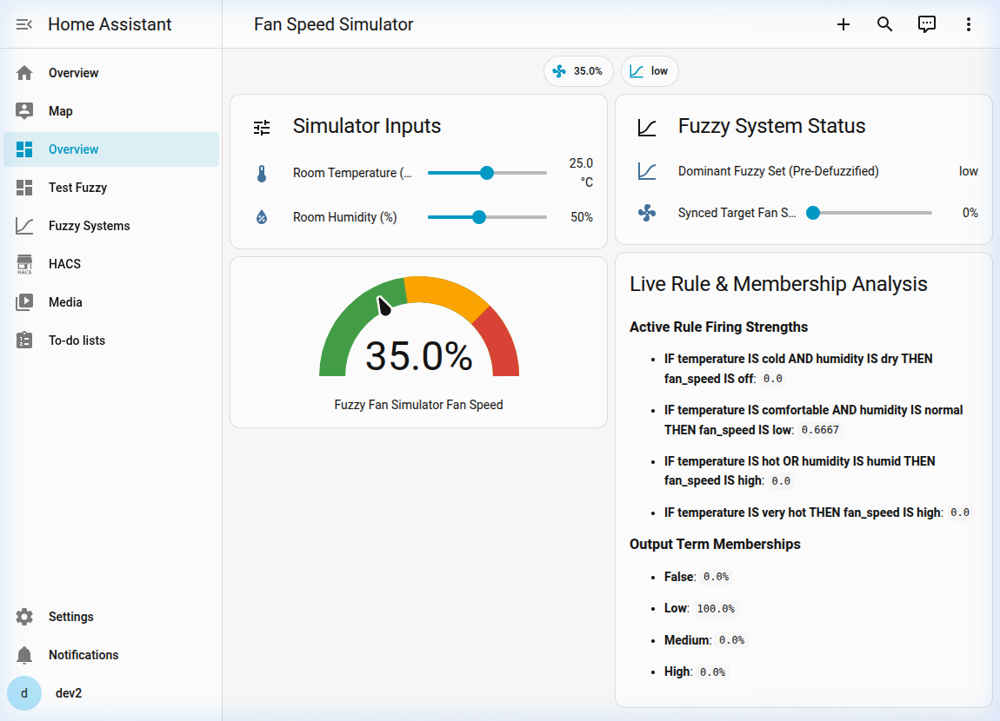

# Step-by-Step Visual Tutorial: Creating and Testing a Fuzzy Control System

Welcome to the **Fuzzy System** step-by-step visual tutorial! This guide walks you through creating, tuning, simulating, and deploying a fuzzy logic controller in Home Assistant without writing code or YAML.



---

## Tutorial Overview: Smart Temperature & Humidity Fan Controller

In this walkthrough, we will model a multi-input, single-output **Smart Fan Controller**:
- **Inputs**:
  - `temperature`: Room temperature from $15^\circ\text{C}$ to $35^\circ\text{C}$ (Linguistic sets: *Cold*, *Comfortable*, *Hot*).
  - `humidity`: Room humidity from $20\%$ to $90\%$ (Linguistic sets: *Dry*, *Normal*, *Humid*).
- **Output**:
  - `fan_speed`: Target fan power from $0\%$ to $100\%$ (Linguistic sets: *Off*, *Low*, *Medium*, *High*).
- **Objective**: Modulate fan speed smoothly using linguistic rules like *"IF temperature is comfortable AND humidity is normal THEN fan speed is low"*.

---

## Step 1: Accessing the Panel & System Catalog

1. Click **Fuzzy Systems** in the Home Assistant sidebar to open `/fuzzy-system`.
2. The **System Catalog** displays all active controllers, their current status badges (`YAML` or `UI`), live output values, and dominant linguistic sets.



### Key Features on this Screen:
- **`+ Add System` Button**: Opens the visual creation wizard to build a new fuzzy system.
- **`📈 Graph` Drawer**: Click to expand a live, real-time waveform of the aggregated output distribution directly on the catalog card.
- **`Edit` / `Clone to UI`**: Open the graphical editor or duplicate a YAML system into a UI-managed configuration entry.

---

## Step 2: General System Settings

Clicking `+ Add System` (or `Edit` on an existing system) brings you to the **General** settings tab:



1. **System Identifier**: A unique name (e.g. `fan_simulator` or `climate_controller`).
2. **Inference Engine**:
   - `Mamdani` *(Recommended)*: Uses continuous output membership curves and defuzzification.
   - `Sugeno`: Uses singleton/constant values, ideal for discrete stepped outputs.
3. **Defuzzification Algorithm**:
   - `Center of Gravity (cog)`: Computes the centroid of the output area. Provides the smoothest transition.
   - Other options include `Bisector of Area (boa)`, `Mean of Maxima (mom)`, and `Weighted Average`.
4. **Recurrence & Circuit Breaker**:
   - Sets update frequency limits (`max_updates_per_period` and `update_period`) to prevent runaway loops if an output sensor feeds back into an input.

---

## Step 3: Configuring Inputs & Tuning Membership Curves

Switch to the **Antecedents (Inputs)** tab to define input variables and their linguistic terms:



### Interactive SVG Curve Canvas (`<fuzzy-curve-canvas>`):
- **Curve Shapes Supported**: Triangular (`trimf`), Trapezoidal (`trapmf`), Gaussian (`gaussmf`), Sigmoidal (`sigmf`), Generalized Bell (`gbellmf`), and Singleton constants.
- **Interactive Editing**:
  - For piecewise functions (`trimf`, `trapmf`), you can click and drag the vertex points directly on the SVG canvas.
  - For continuous functions (`gaussmf`), use the real-time parameter number inputs.
- **Live Input Crosshairs**: When an active Home Assistant entity is selected, a glowing vertical crosshair indicates the live sensor value across all membership sets.

---

## Step 4: Configuring Outputs & Consequents

Switch to the **Consequents (Outputs)** tab to define the controller's target variables:



1. **Universe Range**: Define the domain (e.g. `[0, 100]` for a fan percentage).
2. **Convergence Epsilon ($\epsilon$)**: Deadband threshold (e.g. `0.01`). If the new calculation differs from the previous state by less than $\epsilon$, state updates are suppressed to eliminate jitter.
3. **Linguistic Consequent Terms**: Define the linguistic targets:
   - `off`: `[0, 0, 25]` (Triangular)
   - `low`: `[15, 35, 55]` (Triangular)
   - `medium`: `[45, 65, 85]` (Triangular)
   - `high`: `[75, 100, 100]` (Triangular)

---

## Step 5: Visual Rule Builder

Switch to the **Rules** tab to build natural-language logic:



### Building Linguistic Rules:
- The visual rule builder uses **Disjunctive Normal Form (DNF)**: groups of `AND` conditions joined by `OR`.
- **Antecedent Hedges**: Apply natural modifiers to terms:
  - `very`: Squares membership ($\mu^2$)
  - `somewhat`: Square root of membership ($\sqrt{\mu}$)
  - `not`: Inverts membership ($1 - \mu$)
- **Live Syntax Preview**: A formatted DSL string displays beneath each rule in real time:
  ```text
  IF temperature IS cold AND humidity IS dry THEN fan_speed IS off
  IF temperature IS comfortable AND humidity IS normal THEN fan_speed IS low
  IF temperature IS hot OR humidity IS humid THEN fan_speed IS high
  IF temperature IS very hot THEN fan_speed IS high
  ```

---

## Step 6: Interactive Simulation & Waveforms Workbench

Before connecting real equipment, switch to the **🧪 Simulation & Waveforms** tab:



### Key Features of the Workbench:
1. **Antecedent Sliders**: Drag temperature and humidity sliders to simulate hypothetical environmental conditions.
2. **`⚡ Sync Live Sensor Values`**: Click to pull the exact current values from your physical Home Assistant sensors into the simulator.
3. **Live Term Activation Indicators**: Displays numeric membership degrees for each linguistic term (e.g. `temperature.cold: 0.72`).
4. **Aggregated Output Waveform**:
   - The shaded SVG area illustrates the union of all clipped output membership curves.
   - A bright cyan line highlights the exact defuzzified value (e.g. `83.42%`).
   - A glowing badge shows the winning linguistic term (`High`).
5. **Rule Firing Breakdown**: Horizontal progress bars show which rules are firing and identify bottlenecks.

---

## Step 7: Inspecting the Raw JSON Configuration

If you want to export, back up, or inspect the system configuration, switch to the **Raw Config** tab:



The JSON payload shows the exact internal representation stored in Home Assistant's configuration entries, including universes, parameters, and rule mappings.

---

## Step 8: Adding Dashboard Cards (Zero YAML)

Once your fuzzy system is created, you can monitor its real-time operational status, live input antecedent values, active rule strengths, and defuzzified waveforms directly on your Lovelace dashboards:



There are three convenient ways to add cards to your dashboard:

### Method A: One-Click "📊 Add Card" from the Catalog (Fastest)

You can publish a companion card directly from the Fuzzy System panel without leaving the workbench:

1. In the Home Assistant sidebar, navigate to **Fuzzy Systems** (`/fuzzy-system`).
2. On any system card in the catalog, click the **`📊 Add Card`** button.
3. In the centered modal dialog:
   - **Card Header Title**: Enter an optional title (defaults to your controller's friendly name).
   - **Target View Title**: Enter the view name where the card should appear (e.g. `Fuzzy Systems` or `Overview`). Home Assistant will append the card to this view, automatically creating the view if it doesn't already exist.
   - **Display Toggles**: Choose whether to display:
     - Live aggregated output waveform canvas
     - Live antecedent input sensors
     - Active rule firing strength bars
4. Click **"Add to Dashboard"** for instantaneous one-click addition!
   - *Note*: If your dashboard is configured in YAML mode, click **"📋 Copy Card YAML"** to copy the ready-to-paste card snippet to your clipboard.

---

### Method B: Manual Placement via Lovelace Visual Card Picker

1. On any Lovelace dashboard, click the **Edit Dashboard** (Pencil icon in the top right) > **"+ Add Card"**.
2. Select **"Fuzzy System Controller"** (`custom:fuzzy-system-card`) from the card picker.
3. The visual card editor will appear:
   - **Target Fuzzy System**: Pick your system from the auto-detected dropdown list.
   - **Card Title**: Enter an optional header title.
   - **Visual Toggles**: Enable or disable the live output graph, input sensor chips, and rule firing meters.
4. Click **Save**!

---

### Method C: AI Agent & Automation Support (MCP & WebMCP)

AI assistants and automation agents can also create and insert cards onto your dashboards programmatically:

#### 1. Via Home Assistant MCP Action:
Agents can call the `fuzzy_system.add_to_dashboard` action:
```yaml
service: fuzzy_system.add_to_dashboard
data:
  system_id: fan_simulator
  view_title: "Climate Controls"
  card_title: "Living Room Fan Control"
  show_graph: true
  show_inputs: true
  show_rules: true
```
Or generate YAML via `fuzzy_system.generate_dashboard_card`.

#### 2. Via Browser WebMCP (`window.fuzzySystemMCP`):
In browser-based agent workflows, agents can invoke the `add_card_to_dashboard` WebMCP tool:
```javascript
await window.fuzzySystemMCP.add_card_to_dashboard({
  system_id: "fan_simulator",
  view_title: "Climate Controls",
  card_title: "Living Room Fan Control",
  show_graph: true,
  show_inputs: true,
  show_rules: true
});
```
This enables autonomous AI agents to build complete end-to-end automations—designing the fuzzy system, tuning the membership functions, simulating results, and finally publishing the diagnostic card directly to the user's dashboard.


---

## Summary of Generated Home Assistant Entities

When a fuzzy system named `fan_simulator` is active, Home Assistant exposes the following entities:

| Entity ID | Type | Description |
| :--- | :--- | :--- |
| `sensor.fuzzy_fan_simulator_fan_speed` | Numeric Sensor | Crisp defuzzified output value ($0 - 100\%$). |
| `sensor.fuzzy_fan_simulator_fan_speed_set` | String Sensor | Dominant linguistic set (e.g., `high`, `medium`). |
| `sensor.fuzzy_fan_simulator_status` | Binary Sensor / Status | System operational status (`active`, `rate_limited`). |

---

### Need Advanced YAML or Template Details?
- Refer to [README.md](../README.md) for full YAML configuration reference, rate-limiting parameters, and Jinja2 templating syntax.
